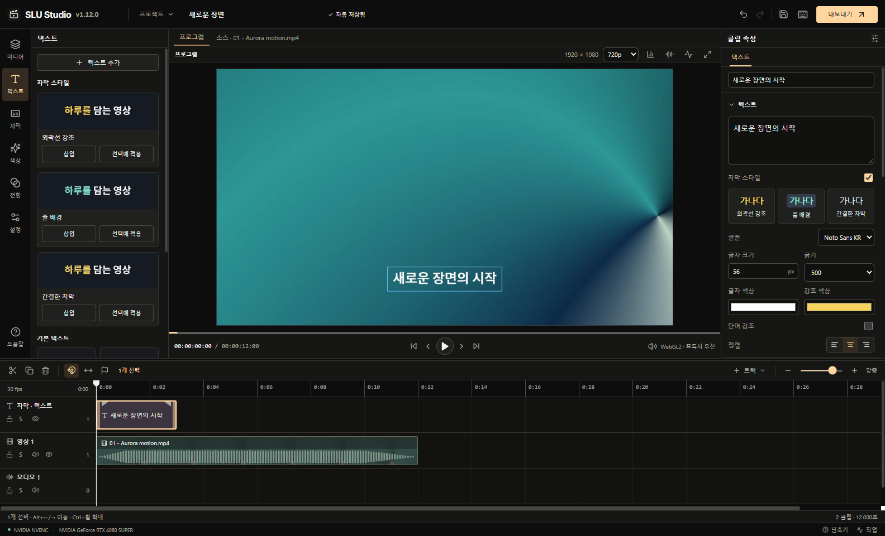

# SLU Studio

Windows x64용 타임라인 영상 편집기.

## 다운로드

- **[1.12.0 설치형 다운로드](https://github.com/sssslu/sluVideoEditor/releases/download/v1.12.0/SLU-Studio-Setup-1.12.0-x64.exe)**
- **[1.12.0 포터블 다운로드](https://github.com/sssslu/sluVideoEditor/releases/download/v1.12.0/SLU-Studio-1.12.0-Windows-x64.exe)**
- [최신 릴리스](https://github.com/sssslu/sluVideoEditor/releases/latest) · [전체 사용설명서 다운로드](https://github.com/sssslu/sluVideoEditor/releases/download/v1.12.0/SLU-Studio-1.12.0-guide.html) · [파일 해시](https://github.com/sssslu/sluVideoEditor/releases/download/v1.12.0/SHA256SUMS-1.12.0.txt)

포터블은 실행할 때 내부 파일을 풀기 때문에 시작 시간이 더 걸릴 수 있습니다. 앱 상단의 이름 옆에서 실행 중인 버전을 확인할 수 있습니다.

## 처음 편집하기

1. 설치형 또는 포터블 EXE를 실행합니다.
2. **가져오기**로 영상을 열고, 소스 모니터의 **끝에 추가**로 타임라인에 넣습니다.
3. 클립 양 끝을 드래그해 자릅니다. 재생 위치에서 `S`로 분할하고 `Ctrl+Z`로 실행 취소합니다.
4. **텍스트 → 텍스트 추가**로 문구를 넣습니다. 음성이 있는 클립은 **자동 자막**에서 모델을 설치한 뒤 인식할 수 있습니다.
5. `Ctrl+S`로 `.sluproj` 프로젝트를 저장합니다.
6. 오른쪽 위 **내보내기**에서 MP4·H.264, 해상도와 프레임 속도를 선택하고 **내보내기 시작**을 누릅니다.

파일 보관과 자막 수정까지 순서대로 설명한 가이드를 제공합니다. [빠른 시작](docs/QUICKSTART.md)

## 기능

- 다중 트랙 편집, 분할·트리밍, 속도 커브, 역재생, 정지 프레임, 키프레임 그래프
- 전환, 크롭·마스크·크로마키, HSL·RGB 곡선·LUT, 색상 스코프
- Whisper 자동 자막, 단어 강조, SRT/VTT 가져오기, Noto Sans KR·Gmarket Sans 글꼴
- 오디오 볼륨·페이드·6밴드 EQ, 파형·레벨 표시
- 인물 배경 제거, 객체 추적, 흔들림 보정, 선택형 2×·4× AI 화질 향상
- GPU 미리보기, 지원되는 GPU 인코더 출력, 프로젝트 모아 저장·복구

AI 화질 향상은 NVIDIA/CUDA가 필요합니다. 1.11에서 RTX 4080 SUPER 16GB·RAM 32GB로 검사한 15프레임은 52.8–100.1초가 걸렸습니다. 모델 준비를 포함한 짧은 720p·1080p 표본이며, 4K AI 출력과 장시간 처리 성능은 미검증입니다. [AI 사용 조건](docs/QUICKSTART.md#ai-화질-향상)

## 문서와 검증 범위

Windows 코드 서명이 없습니다. 대화식 설치 절차와 다른 PC의 호환성은 아직 검증하지 않았습니다. 1.12 검사는 브랜딩·버전 표시와 기본 편집·패키지 실행을 대상으로 했으며, AI 품질 측정은 1.11 기록입니다.

- [빠른 시작](docs/QUICKSTART.md)
- [전체 사용설명서 다운로드](https://github.com/sssslu/sluVideoEditor/releases/download/v1.12.0/SLU-Studio-1.12.0-guide.html)
- [검사 조건과 제한](docs/검증결과.md) · [1.12 배포 검증 기록](https://github.com/sssslu/sluVideoEditor/releases/download/v1.12.0/BUILD-INFO-1.12.0.json)
- [개발·빌드 안내](docs/DEVELOPMENT.md)

앱 코드 라이선스는 GPL-3.0-or-later입니다. [라이선스](LICENSE) · [의존성 고지](resources/licenses)
